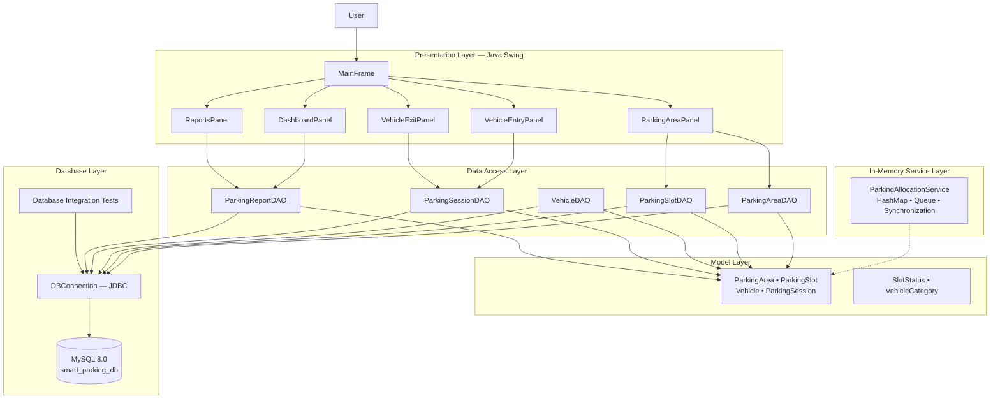

# Smart Parking Slot Allocator — System Architecture

**Architecture note:** `ParkingAllocationService` is a separate in-memory demonstration of allocation concepts. The desktop application's database-backed operations use the DAO layer and JDBC.
