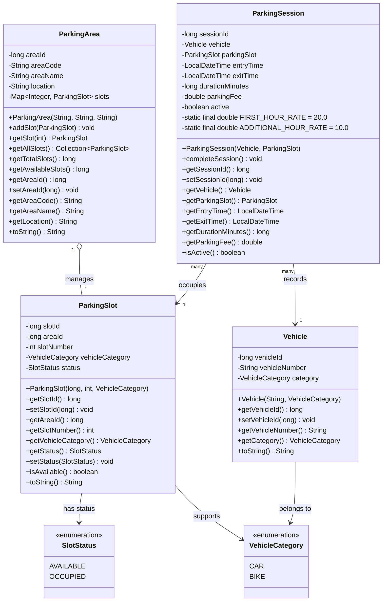

# Smart Parking Slot Allocator — Class Diagram

The following class diagram represents the six model classes and enumerations implemented in the project.

## Class Relationship Notes

1. **ParkingArea and ParkingSlot:** A parking area maintains a collection of parking slots using a HashMap.
2. **ParkingSession and Vehicle:** Each parking session is associated with one vehicle.
3. **ParkingSession and ParkingSlot:** Each parking session occupies one parking slot.
4. **ParkingSlot and SlotStatus:** Each slot maintains its availability status.
5. **ParkingSlot and VehicleCategory:** Each slot supports a specified vehicle category.
6. **Vehicle and VehicleCategory:** Each vehicle belongs to a supported vehicle category.

## Implementation Notes

- `ParkingArea` uses a HashMap to maintain its parking slots.
- `ParkingSession` validates vehicle-slot category compatibility before creating a session.
- `ParkingSession` calculates parking duration and fees when a session is completed.
- Fee constants are declared as `static final`.
- `SlotStatus` and `VehicleCategory` are Java enumerations.

**Project:** Smart Parking Slot Allocator  
**Project Code:** JAVA-P027
